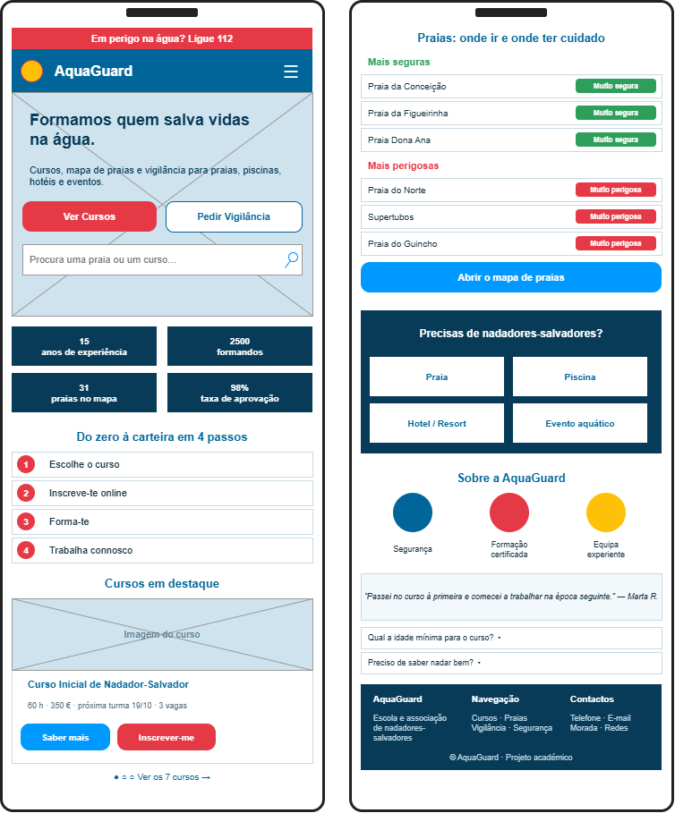
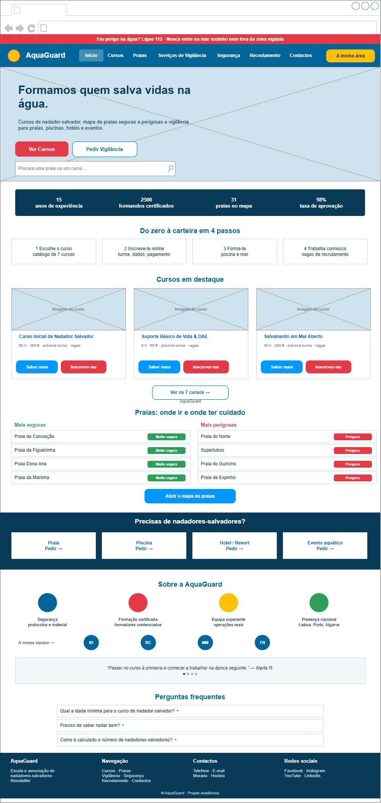
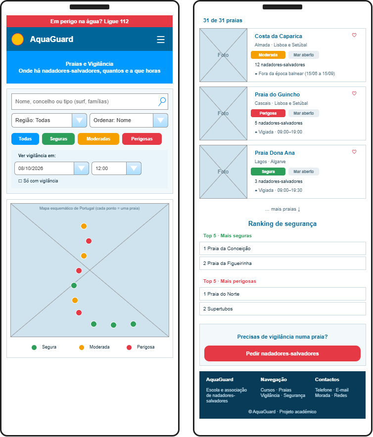
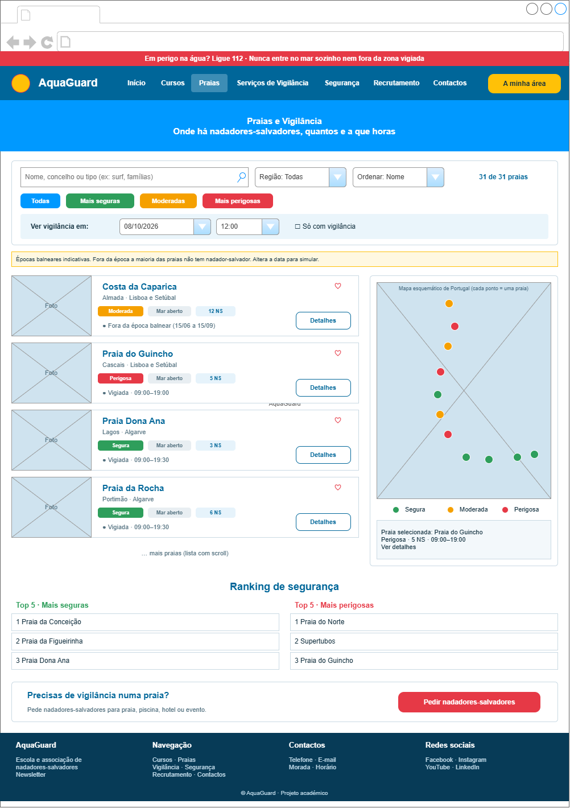

# AquaGuard: plataforma de cursos e vigilância aquática

Website responsivo (mobile e desktop) que liga entidades formadoras, concessionários e nadadores-salvadores.
Projeto da unidade curricular **Desenvolvimento para a Web**, Licenciatura em Ciência de Dados para a Gestão, 2026/2027.

## Grupo

- Manuel João Santos: 2024153226
- Tomás Abreu: 2024140672


## Para que serve

O site funciona como um quadro de anúncios organizado, em vez de anúncios espalhados por grupos de redes sociais. Responde a três necessidades:

1. **Encontrar um curso:** entidades formadoras publicam cursos e quem quer formar-se contacta a entidade.
2. **Encontrar trabalho:** concessionários de praias publicam vagas de nadador-salvador e os nadadores-salvadores candidatam-se.
3. **Contactar a plataforma:** formulário de contacto para entidades, concessionários e nadadores-salvadores.

Navegação simples, menu fixo no topo e logótipo que volta sempre ao Início.

## Estrutura do website

```
Início ....... apresentação, cursos e vagas em destaque, perguntas frequentes
├── Cursos ... catálogo de cursos e formulário para publicar um curso
├── Praias ... vagas de nadador-salvador e formulário para publicar uma vaga
└── Contactos  formulário de contacto
```

## Funcionalidades

- Menu fixo no topo, responsivo (em telemóvel, o logótipo fica por cima do menu).
- Página Início com apresentação, números, "como funciona", cursos e vagas em destaque e perguntas frequentes.
- Página Cursos com catálogo de cursos de várias entidades e formulário para publicar um curso.
- Página Praias com vagas de nadador-salvador de vários concessionários e formulário para publicar uma vaga.
- Página Contactos com formulário de mensagem.
- Layout responsivo para telemóvel, tablet e computador.

**Só o desenho, por agora (fica para a E3):** filtros, pesquisa e o envio dos formulários.

## Tecnologias

HTML5 e Tailwind CSS (versão browser).

## Estado do projeto

E1: grupo, descrição e mockups. E2: estrutura em HTML e responsividade (4 páginas). E3 (a fazer): JavaScript, PHP e base de dados.

Após analisar o funcionamento real do mercado, o grupo simplificou o conceito inicial para uma plataforma de anúncios, mais realista e exequível.

## Possíveis evoluções

- Base de dados e envio real dos formulários (E3).
- Operador de Viatura 4x4 e Embarcações de Pequeno Porte entre os cursos.
- Área pessoal, candidatura online e mapa de praias.
- Dados reais das praias (APA/Infopraia).

## Esquemas 

- **Inicio: Mobile**



- **Inicio: Desktop**



- **Praias: Mobile**



- **Praias: Desktop**




## Referências
| Nome | Site |
|---|---|
| Instituto de Socorros a Náufragos / Autoridade Marítima Nacional | https://www.amn.pt |
| APA · Infopraia | https://infopraia.apambiente.pt |
| RNLI · Beach safety | https://rnli.org |
| Surf Life Saving Australia · Beachsafe | https://beachsafe.org.au |
| European Resuscitation Council · Guidelines | https://cprguidelines.eu |
| Unsplash | https://unsplash.com |
| draw.io (diagrams.net) | https://app.diagrams.net |
